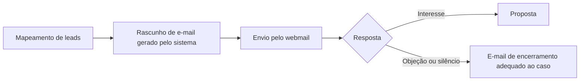

# Spore Prospector: estudo de caso

Sistema de prospecção comercial da Spore, usado para encontrar e abordar potenciais clientes de sites e automações em qualquer nicho e região. O código é privado, então este repositório apresenta o sistema, as decisões de produto e a minha participação nele: **opero e ajudo no desenvolvimento do sistema, participo da idealização do negócio e planejo melhorias**, num produto construído com desenvolvimento assistido por IA.

## O problema

Prospectar clientes um a um é lento: é preciso encontrar o contato, escrever um e-mail adequado a cada pessoa, acompanhar quem respondeu e decidir quando insistir ou encerrar. Sem uma ferramenta, esse acompanhamento se perde em planilhas e rascunhos soltos.

## Como o fluxo funciona

## Melhorias que idealizei e foram implementadas no sistema

### 1. Pipeline de encerramento automatizado por tipo de objeção

**Problema:** o fluxo de automação terminava num único modelo de e-mail de encerramento (*breakup*). Toda recusa caía no mesmo texto, e adaptar a mensagem a cada caso virava trabalho manual fora do sistema, justamente na etapa em que o lead está mais perto de se perder.

**Análise:** agrupei as respostas reais em seis casos recorrentes: "está caro", "já tenho site", "já tenho automação", "já tenho site e automação", "agora não é o momento" e silêncio.

**O que mudou no sistema:** aperfeiçoei a automação e o fluxo do pipeline para tratar cada objeção como um caminho próprio. O e-mail de encerramento passou a ser escolhido de acordo com a objeção do lead, com argumento e tom específicos para cada caso, e a etapa final da cadência deixou de depender de reescrita manual.

### 2. Feedback visual integrado ao fluxo de rascunhos

**Problema:** quando a automação criava o rascunho no webmail, o sistema avisava com um `alert()` do JavaScript, que bloqueia a tela, some ao ser fechado e não deixa registro de quais rascunhos foram gerados.

**O que mudou no sistema:** o `alert()` foi substituído por um aviso visual dentro do próprio sistema, que não interrompe a operação e mantém visível o estado de cada rascunho criado pela automação.

### 3. Segurança para o deploy (em andamento)

Participo da idealização das funcionalidades de segurança que o sistema vai precisar quando for publicado em produção.

## O que aprendi

- Os melhores requisitos vieram do uso real do sistema, não da especificação inicial.
- Agrupar respostas reais em categorias transforma reclamações soltas em requisitos claros.
- Com desenvolvimento assistido por IA, o gargalo deixa de ser escrever código e passa a ser saber exatamente o que construir.
